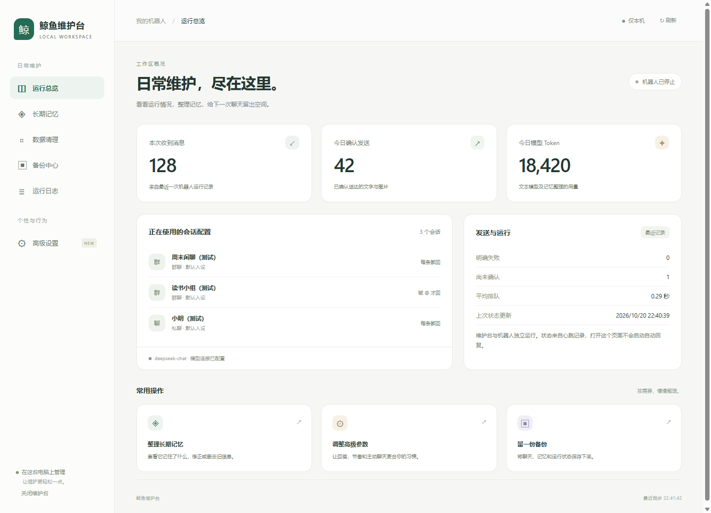
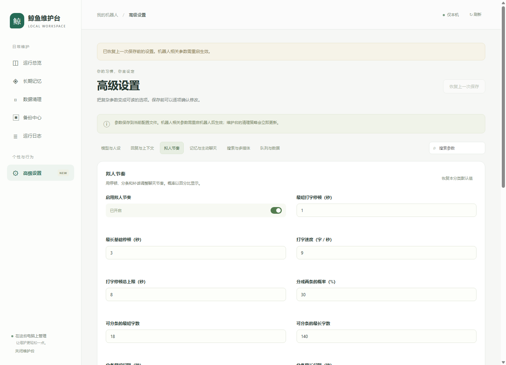

# 可视化维护台

双击项目根目录的 **start_manage.bat**。浏览器会打开 [本地维护台](http://127.0.0.1:8010/manage)。

维护台独立运行，无需模型 Key，不会启动微信或自动回复。首次使用仍需安装项目基础依赖；已有项目环境可直接打开。
再次双击时会复用已经启动的维护台，不会重复启动服务。

## 六个入口

| 页面 | 可以做什么 |
| --- | --- |
| 运行总览 | 查看运行心跳、收信数量、今日确认发送、Token 用量、会话与发送情况 |
| 长期记忆 | 选择会话，每行编辑一条事实，保存或清空；自动检测后台更新冲突 |
| 数据清理 | 填写本次保留天数，预览待删清单，确认后执行 |
| 备份中心 | 创建本地备份，下载已有 ZIP；不包含模型 Key 或原始媒体 |
| 运行日志 | 读取机器人或维护台最近 200 行日志，按提醒、错误筛选；自动隐藏密钥 |
| 高级设置 | 调整 91 项参数，搜索设置，恢复分类默认值，预览并保存修改，恢复上一次保存 |

## 高级设置

参数分成六类：

- **模型与人设**：模型名、回答发散程度、输出预算、超时重试、默认角色和人设。
- **回复与上下文**：触发规则、@、时间感知、消息合并、限流、回复长度及历史预算。
- **拟人节奏**：打字停顿、打字速度、分条概率与间隔、补话内容、偶尔沉默、@ 概率。
- **记忆与主动聊天**：记忆整理频率和容量、安静时间、活跃时段、主动动作概率及每日上限。
- **搜索与多媒体**：搜索结果与预算、识图、语音模型、文件大小、生图服务、尺寸和配额。
- **队列与数据**：读取间隔、线程数、排队容量、消息有效期、发送等待、保留天数和日志级别。

操作步骤：

1. 点击分类，或在搜索框输入参数名称。
2. 修改表单，底部会显示未保存的项数。修改此时尚未写入配置。
3. 点击“查看并保存”，核对修改前后的值，再确认保存。
4. 机器人相关参数需重启机器人后生效：在机器人运行窗口按 Ctrl+C，随后双击 start_bot.bat。

维护台的清理默认策略在保存后立即更新。“恢复本分类默认值”只修改表单，仍需点击保存。
“恢复上一次保存”在本次维护台服务运行期间有效；重启维护台后不保留撤销记录。
如果其他窗口或程序修改了配置，保存与恢复会停止执行，避免覆盖新内容。此时点击右上角“刷新”重新读取。

界面只修改允许调整的参数，保留原配置的注释、独立人设和连接密钥。
模型 Key、连接地址、数据目录和监听目标仍由当前配置文件管理。切换生图供应商前需准备对应服务的模型、连接与 Key。
部分会话有自己的触发规则或人设，修改全局默认值不会覆盖这些独立配置。

## 记忆与清理

记忆每行一条，每条最多 80 字，总数遵守高级设置中的记忆容量。后台提取或其他窗口已更新档案时，会要求重新读取，保留双方的修改机会。
清空记忆只清空长期事实，历史聊天记录仍保留，后续开启的记忆提取也可能根据聊天重新整理事实。

清理前请停止机器人。仍有新鲜运行心跳时，维护台会阻止执行清理。
填入 0 天表示不按时间清理该类数据；生成图片还可能按 `max_keep` 数量规则筛选。
预览有效期为 5 分钟，只删除这份清单中的文件，不把预览后出现的新文件加入删除。
文件在预览后发生改变时，需重新预览；删除本身无法撤销，建议提前备份。

## 运行状态与退出

页面每 10 秒读取一次运行记录。机器人约每分钟写入心跳，停止时会记录停止状态。
旧版本机器人未写停止标记时，需要等待最近心跳过期后才能清理；运行记录不是微信在线状态的保证。

关闭浏览器标签页只关闭页面。要停止维护台服务，点击左下角“关闭维护台”；机器人进程不受影响。
手机尺寸的布局也可使用，但服务仅绑定本机，不对局域网或公网开放。

命令行启动（可选）：

```powershell
.\.venv\Scripts\python.exe -m src.main manage --open
.\.venv\Scripts\python.exe -m src.main manage --port 8011 --open
```

已有网页聊天测试台也可通过 `/manage` 进入维护页。独立维护台使用 8010 端口，聊天测试台默认使用 8000 端口。
日志分别保存到 `logs/manage.log` 和 `logs/bot.log`；不会因为打开维护台而创建模型客户端或发送微信消息。

## 界面预览

以下截图均使用临时测试数据，不代表实际机器人运行情况。




